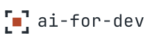
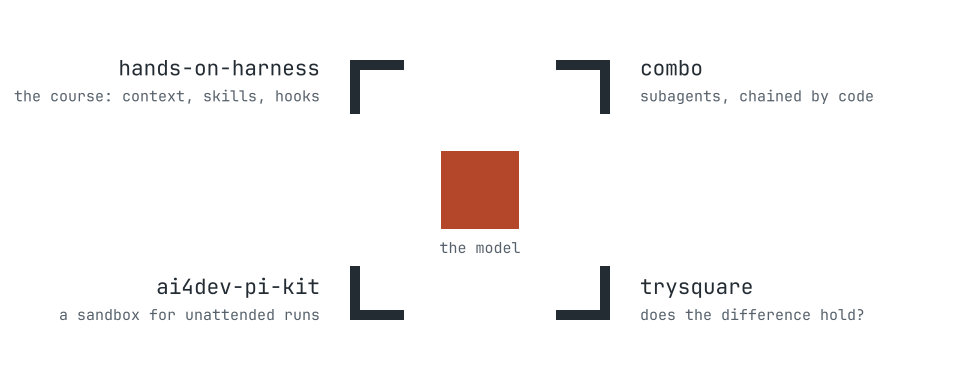

<h1>
  <picture>
    <source media="(prefers-color-scheme: dark)" srcset="brand/ai-for-dev-lockup-dark.svg">
    
  </picture>
</h1>

Course material and small tools for using coding agents well. The model varies from one
run to the next; what you can change is the harness around it, so we rebuild each piece of
that harness by hand and measure what it actually changes.

Everything here was written for the [IA4Dev training school](https://ia4dev-2026.sciencesconf.org/)
(19 to 22 October 2026), for people in higher education and research who already code. The
course does not try to convince anyone to use AI. It takes the next question: how to use it
well, if you choose to.

  <picture>
    <source media="(prefers-color-scheme: dark)" srcset="brand/ai-for-dev-map-dark.svg">
    
  </picture>

## Start with the course

**[Hands-on Harness](https://ai-for-dev.github.io/hands-on-harness/)** is written in French
and published in [English](https://ai-for-dev.github.io/hands-on-harness/en/) and
[Spanish](https://ai-for-dev.github.io/hands-on-harness/es/). You work on one repository
from start to finish, a small game with real bugs, and rebuild the sandbox, context, skills,
subagents, workflows and hooks on [Pi](https://pi.dev) before measuring them.

| Repository | What it is |
| --- | --- |
| [hands-on-harness](https://github.com/AI-for-dev/hands-on-harness) | The course itself, built with VitePress |
| [neon](https://github.com/AI-for-dev/neon) | The brick breaker you maintain during the course: playable, buggy, with a backlog of tickets |
| [slides](https://github.com/AI-for-dev/slides) | The workshop slides for the three days, built with Slidev |

## The tools

| Repository | What it is |
| --- | --- |
| [combo](https://github.com/AI-for-dev/combo) | A Pi extension where a Markdown file becomes an agent, and agents compose into workflows written in TypeScript |
| [trysquare](https://github.com/AI-for-dev/trysquare) | Replays a scenario many times and tells you whether the gap between two configurations survives resampling |
| [trysquare-starter](https://github.com/AI-for-dev/trysquare-starter) | The experiments of act 3, ready to replay against NEON |
| [ai4dev-pi-kit](https://github.com/AI-for-dev/ai4dev-pi-kit) | A Docker Sandboxes kit that runs Pi in a micro-VM, away from your keys, on the domains you allow |

The tools only drive Pi today and have not been tested in production. Where a more mature
alternative exists, the course points to it.
